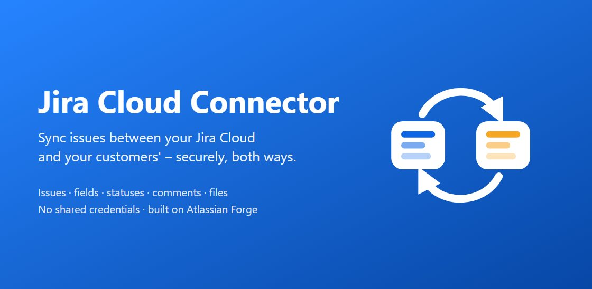

Oct 28, 2026 · @Rahul Savaikar

# Jira Cloud Connector Documentation

Connect Jira Cloud projects across organisations and synchronise issues,
fields, statuses, comments, and attachments without sharing credentials.

## Documentation

- [Product guide](./product-guide.html) — Features, requirements, security, and limitations.
- [Admin guide](./admin-guide.html) — Installation, pairing, configuration, and maintenance.
- [For Jira users](./for-jira-users.html) — Everyday use and the Partner sync panel.
- [Troubleshooting](./troubleshooting.html) — Common messages, synchronisation problems, and solutions.

## Complete technical documentation

For detailed architecture, development instructions, and technical references,
see the [complete documentation on GitHub](https://github.com/rsavaikar/documentation/blob/main/README.md).

## Support and policies

- [Support](./support.html) — Contact details and information to include when requesting help.
- [Privacy policy](./privacy-policy.html) — Data processing, storage, sharing, and security.
- [End-user terms](./end-user-terms.html) — Terms governing use of Jira Cloud Connector.
