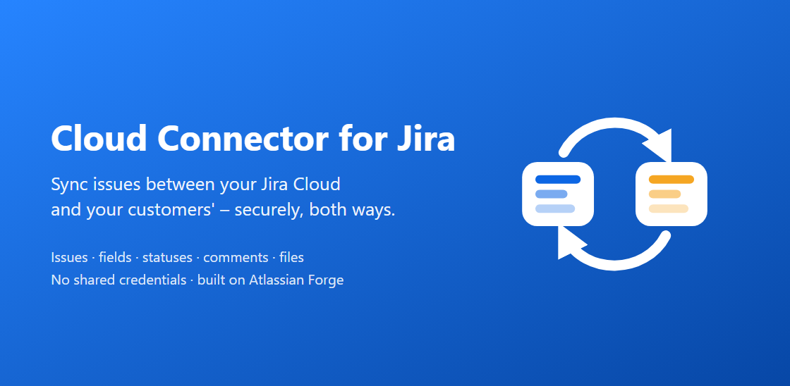

# Cloud Connector for Jira Documentation

*Last updated: 28 October 2026 · Rahul Savaikar*

Connect Jira Cloud projects across organisations and synchronise issues, fields, statuses, comments and attachments without sharing credentials.

## Documentation

- [Product guide](./product-guide.html) — Features, requirements, security and limitations.
- [Admin guide](./admin-guide.html) — Installation, pairing, configuration and maintenance.
- [For Jira users](./for-jira-users.html) — Everyday use and the Partner sync panel.
- [Troubleshooting](./troubleshooting.html) — Common messages, synchronisation problems and solutions.

## Support and policies

- [Support](./support.html) — Contact details and what to include when you ask for help.
- [Support SLA](./sla.html) — Support hours, response targets and security fixes.
- [Privacy policy](./privacy-policy.html) — Data processing, storage, sharing and security.
- [End-user terms](./end-user-terms.html) — Terms governing use of Cloud Connector for Jira.

## Technical reference

Architecture, protocol and storage details are in the [technical reference on GitHub](https://github.com/rsavaikar/documentation/blob/main/README.md).
