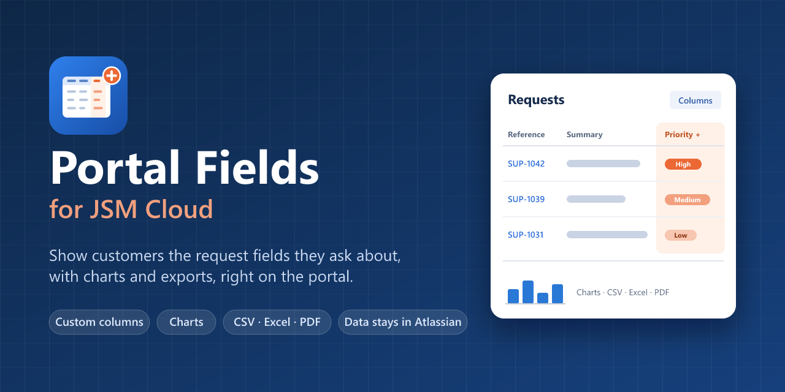

# Portal Fields for JSM Cloud Documentation

*Last updated: 28 October 2026 · Rahul Savaikar*

Show your customers the request fields they ask about, such as priority, SLA times and organisations, in a sortable, filterable request report and charts on the Jira Service Management customer portal.

## Documentation

- [Product guide](./product-guide.html) — Features, requirements, security and limitations.
- [Admin guide](./admin-guide.html) — Installation, settings per project, and maintenance.
- [For portal customers](./for-customers.html) — Using the request report and charts on the portal.
- [Troubleshooting](./troubleshooting.html) — Messages you may see and what to do.

## Support and policies

- [Support](./support.html) — Contact details and what to include when you ask for help.
- [Support SLA](./sla.html) — Support hours, response targets and security fixes.
- [Privacy policy](./privacy-policy.html) — Data processing, storage and security.
- [End-user terms](./end-user-terms.html) — Terms governing use of Portal Fields for JSM Cloud.
